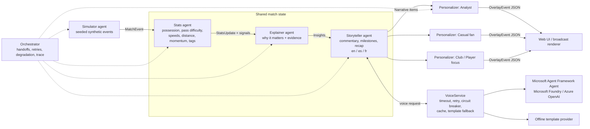

# Matchday Intelligence

**Five specialised AI agents turn synthetic football match events into explainable, personalized,
broadcast-ready match intelligence: timed JSON overlays plus a live web UI.**

Built for the Microsoft *Inside the Game* Premier League Hackathon. All clubs, players, venues
and events are fictional and synthetic. There's no real footage, data or trademarks.

## The pitch

Scorelines don't tell the story. Matchday Intelligence ingests match events as they happen and
answers *why it matters*: control vs chaos, pressing shifts, momentum swings, chance quality. It
renders that as on-screen overlays and then personalizes it, so a data-hungry analyst and a
casual fan get two genuinely different experiences of the same match, in English, Spanish or
French, built around their favorite club or a single player they follow.

**Problem:** broadcasters and streamers produce one feed for everyone, and stats graphics report
*what* happened without the context.
**Solution:** one shared intelligence pipeline, many audience-specific outputs, delivered as a
documented, machine-readable overlay contract that any graphics engine can render.

## Architecture



| Agent | Role | Writes to shared state |
|---|---|---|
| **Simulator** | Seeded, deterministic match generator: passes (coords, distance, accuracy, ball speed), carries, shots (speed, xG), tackles, interceptions, pressure, possession changes, sprints, per-minute distance tracking, metadata. Streams in real time at any speed. | events |
| **Stats** | Live aggregation: possession, pass accuracy, **pass difficulty rating (0-10)**, ball and shot speed, distance covered, momentum index, threshold-triggered player tags (sprint ≥32.5 km/h, shot ≥105 km/h, 10 km run), milestones. | stats, signals |
| **Explainer** | Decides which moments matter and **why**: goal context (go-ahead, equaliser, against the run of play, build-up, low or high xG), big chances, elite passes, momentum swings, **control vs chaos** rhythm phases, pressing shifts. Every insight carries reason codes and the evidence numbers behind them. | insights |
| **Storyteller** | Language-neutral narrative items, then voices them per viewer: commentary lines, milestones, full-time recap, in **English, Spanish and French**. | narrative |
| **Personalizer** | One per viewer profile. **Analyst** mode gets dense stat panels, per-minute momentum with history and full evidence. **Casual** mode gets big moments only, in plain language. **Favorite club** adds boosted moments, momentum from your club's perspective and fan alerts. **Player focus** adds a live player card and every moment involving that player. | overlays |

**Coordination and failure recovery:** the orchestrator runs every hop through a guarded call
that times it, retries transient failures, and degrades gracefully. A failing agent contributes
nothing for that event while the match keeps going, and a Stats failure skips only that event.
Language generation has its own resilience layer: significance gating (only big moments call
the model, to control cost and latency), a timeout, a retry, a **circuit breaker** and a cache,
with a **guaranteed deterministic template fallback**. Every retry, fallback and circuit event is
streamed as an `agent_trace` overlay and shown on the UI's *Agents* tab. You can demo this with
the **Simulate AI outage** toggle (`faults=0.35`).

## Microsoft technology used

- **Microsoft Agent Framework** (`agent-framework-core`): the Storyteller and Explainer voices are
  Agent Framework `Agent`s, one per role with role-specific instructions.
- **Microsoft Foundry** (`agent-framework-foundry` `FoundryChatClient`), or **Azure OpenAI**
  (`OpenAIChatCompletionClient`), selected with `MDI_PROVIDER`.
- **Microsoft Entra ID keyless auth**: `DefaultAzureCredential`, which uses the managed identity
  in Azure and `az login` locally. There are no API keys anywhere.
- **Azure Container Apps**, **Azure Container Registry**, **Log Analytics**, and a user-assigned
  managed identity, all provisioned by **Bicep** through the **Azure Developer CLI (azd)**.
- Built with **GitHub Copilot** and the **GitHub CLI**.

> Note: the five-agent orchestration is a purpose-built async orchestrator, not an Agent Framework
> `Workflow`. We chose this because it needs deterministic, per-event, sub-millisecond handoffs for
> live play. Agent Framework powers the LLM-backed agents. Moving the orchestration onto AF
> Workflows is a natural next step.

## Overlay contract (machine-readable)

Every output is an `OverlayEvent` (JSON Schema: [`docs/overlay-schema.json`](docs/overlay-schema.json),
also served live at `GET /api/schema`). Key fields:

- `clock` {`t` feed seconds, `period`, `display`}: syncs with the match feed.
- `type`: `scorebug | stat_panel | momentum | player_tag | player_card | commentary | insight |
  milestone | fan_alert | event_marker | recap | agent_trace`.
- `display` {`slot`, `duration_ms`, `priority`, `anchor` (pitch x/y in metres), `replace_key`}:
  tells a renderer where to place the overlay, for how long, and which overlay it replaces.
- `headline`, `text`, `data` (a type-specific payload), and `evidence` (the stats that justify the claim).
- `significance`, `source_agents` (the handoff chain), `provider` (which model or template
  voiced it), and `audience` (mode, language, club, player).

Ids are stable: the same seed and profile always produce the same overlays.

## Run locally

```bash
python3.12 -m venv .venv && source .venv/bin/activate
pip install -r requirements-dev.txt          # or requirements.txt for offline-only
uvicorn app.main:app --reload --port 8000    # open http://localhost:8000
```

Offline template mode is the default and needs no cloud account. To use Microsoft Foundry:

```bash
cp .env.example .env    # set MDI_PROVIDER=foundry, FOUNDRY_PROJECT_ENDPOINT, FOUNDRY_MODEL
az login                # keyless: DefaultAzureCredential
set -a; source .env; set +a; uvicorn app.main:app --port 8000
```

Docker: `docker build -t matchday . && docker run -p 8000:8000 matchday`

### API

| Endpoint | Purpose |
|---|---|
| `GET /api/stream?seed&mode&lang&club&player&speed&start&faults` | Live SSE stream of overlay envelopes (`meta`, `overlays`, `end`) |
| `GET /api/match/{seed}` | Match metadata (fictional clubs and squads) |
| `GET /api/match/{seed}/events` | Raw synthetic event dataset |
| `GET /api/match/{seed}/timeline?mode&lang&club&player` | Full overlay timeline as JSON |
| `GET /api/match/{seed}/compare` | Analyst vs casual for the same match, side by side |
| `GET /api/match/{seed}/recap` | Personalized full-time recap |
| `GET /api/schema`, `/api/docs`, `/healthz` | Schema, OpenAPI docs, health |

Batch endpoints (`timeline`, `compare`, `recap`) use the deterministic template voice, run in a
worker thread and are cached per seed and profile; the live stream is where model voices are used.
Model use is bounded app-wide: a single shared provider, cache and circuit breaker, plus lifetime
and hourly call budgets that fall back to templates. Requests are rate limited per client, live
streams are capped globally and per client and have a maximum duration, and `speed` must be 0
(as fast as possible) or 5-600.

All parameters are validated (enums, ranges, id patterns, finite numbers). CORS is off unless `ALLOWED_ORIGINS`
is set, responses carry a strict CSP and security headers, concurrent streams are capped,
dependencies are pinned, and the container runs as a non-root user. The code never uses `eval`.

## Tests

```bash
pytest          # all offline, no Azure credentials needed (pytest --cov=app for coverage)
ruff check .    # lint
```

The tests cover simulator determinism and realism, every agent, orchestration handoffs, agent
failure retry and degradation, provider outage fallback, the circuit breaker, timeouts, stream
resume, personalization differences (analyst vs casual, club, player focus, language), overlay
schema validity, a committed-schema drift check, the API, input validation, CORS and SSE. The real
Agent Framework `Agent` path runs against a fake chat client.

## Deploy to Azure Container Apps (azd)

Prerequisites: a personal Azure subscription, the Azure CLI and the Azure Developer CLI.

```bash
az login && azd auth login
azd env new matchday-intel
azd env set AZURE_LOCATION eastus2
# Optional, for Microsoft Foundry voices (otherwise the app runs in offline template mode):
azd env set MDI_PROVIDER foundry
azd env set FOUNDRY_PROJECT_ENDPOINT "https://<resource>.services.ai.azure.com/api/projects/<project>"
azd env set FOUNDRY_MODEL gpt-4o-mini
azd up                      # provisions infra/main.bicep, builds and pushes the image, deploys
```

Then grant the app's managed identity access to your Foundry resource (keyless):

```bash
PRINCIPAL=$(azd env get-value WEB_IDENTITY_PRINCIPAL_ID)
az role assignment create --assignee-object-id "$PRINCIPAL" --assignee-principal-type ServicePrincipal \
  --role "Azure AI User" --scope <foundry-resource-id>
```

`azd env get-value WEB_URL` prints the public URL to give the judges.

## Judge testing instructions

1. Open the public URL. No login is needed. Leave **seed 6**, choose **Casual fan** and press **Kick off**. At 30× speed a full match takes about 3 minutes.
2. Switch to **Analyst** mid-match. The stream resumes at the same minute with dense stat panels, momentum history and evidence chips.
3. Pick a **Favorite club** and watch for fan alerts and momentum from your perspective. Then pick a **Player focus** to get a live player card.
4. Change **Language** to Español or Français. Every overlay, including the recap, switches language.
5. Press **Compare modes** to see the same match's top moments for an analyst and a casual fan side by side.
6. Tick **Simulate AI outage**. The *Agents* tab shows retries, fallbacks and the circuit breaker, and the broadcast never stops.
7. Open the **Overlay JSON** tab, or `GET /api/match/6/timeline?mode=analyst`, to see the machine-readable contract.

## Demo video script (under 2 minutes)

| Time | Shot |
|---|---|
| 0:00-0:12 | Hook: "Scorelines don't tell the story." Title card, then the five-agent diagram. |
| 0:12-0:35 | Kick off in Casual mode. Scorebug, momentum and a goal insight explain *why* it mattered (e.g. against the run of play). |
| 0:35-0:55 | Flip to Analyst at the same minute: stat panel, pass-difficulty and xG evidence chips, momentum sparkline. |
| 0:55-1:10 | Favorite club fan alert, player focus card, switch to Spanish and then French. |
| 1:10-1:25 | Compare modes: same intelligence, two audiences. |
| 1:25-1:40 | Simulate AI outage: Agents tab shows retries, fallbacks and the circuit breaker, and the overlays keep flowing. |
| 1:40-1:55 | Overlay JSON and schema, then the Azure architecture (Container Apps, Foundry, Agent Framework, keyless identity). Close with the repo URL. |

Use no copyrighted music and show only the fictional clubs.

## Project layout

```
app/simulator.py            Simulator agent (synthetic data generation)
app/agents/stats.py         Stats agent
app/agents/explainer.py     Explainer agent
app/agents/storyteller.py   Storyteller agent (+ i18n.py templates en/es/fr)
app/agents/personalizer.py  Personalizer agent
app/orchestrator.py         Shared state, handoffs, retries, trace
app/providers/              Template, Agent Framework (Foundry/Azure OpenAI), resilience layer
app/schema.py               Overlay contract (pydantic -> JSON Schema)
app/main.py, app/static/    FastAPI API + SSE, web UI
infra/, azure.yaml          Bicep + azd for Azure Container Apps
```

## License

MIT. See [LICENSE](LICENSE).
